  
  

### 👋 About me

I build apps people actually keep on their phones: **Android apps in Kotlin and Jetpack Compose**, desktop apps for Windows, and modern web front ends. I care about clean interfaces, offline-first data and security that holds up when someone looks closely.

- 🔨 Working on **[Ostoja](https://github.com/xwolter/ostoja)**, a local-first password manager and 2FA app for Android, Windows and Firefox
- 🧠 Exploring LLMs, automation and cloud architectures
- 💬 Ask me about Kotlin, Compose, React, Firebase or browser extensions
- 📫 **[wolter.biznes@gmail.com](mailto:wolter.biznes@gmail.com)**

 

## 🚀 Projects

<table>
  <tr>
    <td colspan="2">
      
       
      <b>Passwords and 2FA codes on your phone and PC, no cloud.</b> The phone and the PC sync directly over home Wi‑Fi with end-to-end encryption. The Firefox extension opens a site and signs you in by itself, 2FA code included.
        
      
      
      
      
      
      
       
      <a href="https://xwolter.github.io/ostoja/"><b>Website</b></a> · <a href="https://github.com/xwolter/ostoja/releases/latest"><b>Download</b></a> · <a href="https://github.com/xwolter/ostoja"><b>Code</b></a>
        
      
    </td>
  </tr>
  <tr>
    <td width="50%" valign="top">
      <h3><a href="https://github.com/xwolter/forma">FORMA</a></h3>
      Training and food diary for Android. Log sets during a workout, count calories and macros, track progress. Works offline, with 300 exercises and Polish food data built in.
        
      
      
      
      
        
      
      
    </td>
    <td width="50%" valign="top">
      <h3><a href="https://github.com/xwolter/noct-dzienniczek">Noct Dzienniczek</a></h3>
      Student diary for Android built on the USOS API used by Polish universities: timetable, test points, grades and a GPA forecast, with widgets and shared exam dates for your year.
        
      
      
      
      
        
      
      
    </td>
  </tr>
</table>

 

## 🧰 Tech stack

<table>
  <tr>
    <td><b>Mobile & desktop</b></td>
    <td>
      
      
      
      
      
    </td>
  </tr>
  <tr>
    <td><b>Frontend</b></td>
    <td>
      
      
      
      
      
    </td>
  </tr>
  <tr>
    <td><b>Backend</b></td>
    <td>
      
      
      
      
      
      
    </td>
  </tr>
  <tr>
    <td><b>Data & cloud</b></td>
    <td>
      
      
      
      
      
    </td>
  </tr>
  <tr>
    <td><b>Tools & AI</b></td>
    <td>
      
      
      
      
    </td>
  </tr>
</table>

Thanks for stopping by 👋

